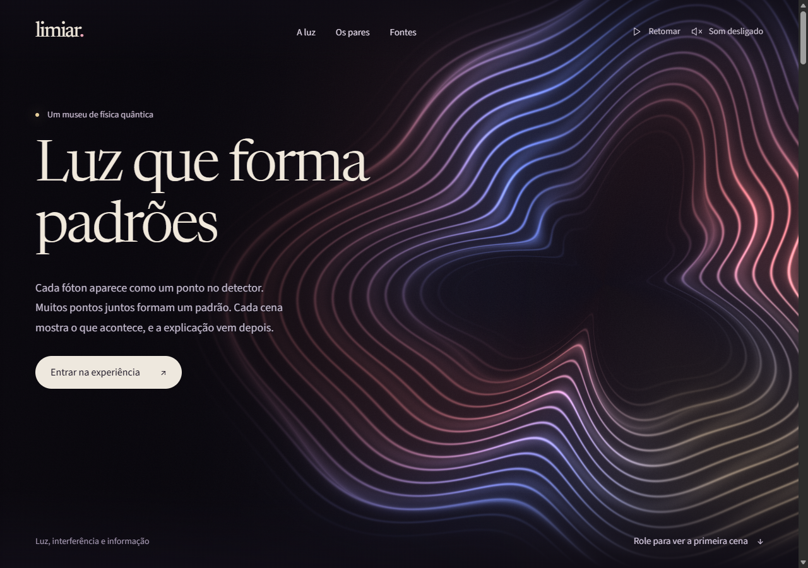

# Limiar

Museu visual de física quântica. Cenas de luz, ondas e registros de medição apresentam superposição, interferência, coerência, decoerência e entrelaçamento, com explicações curtas e aprofundamento opcional.



## Sobre esta versão

Esta é a versão pública de demonstração do Limiar, derivada de um projeto desenvolvido em um repositório privado. A publicação reúne o código da exposição em uma versão independente, com histórico próprio, para consulta, execução local e hospedagem do site. O histórico anterior e os documentos internos de trabalho não fazem parte desta distribuição.

## A visita

- **Medições de um fóton:** oito cenas passam pelas ondas de água, detecção individual, superposição de caminhos, recombinação, fase, contato com o ambiente, isolamento e nova preparação.
- **Medições de dois sistemas:** quatro cenas mostram resultados locais, comparação dos registros, orientação dos analisadores e ausência de sinalização entre os lados.
- **Aprofundamento:** equações, limites do modelo, uma comparação CHSH em quatro ajustes e referências de física.
- **Fontes:** uma apresentação da medição com colapso e outra sem colapso, delimitadas como interpretações.

A sequência pode ser assistida ou percorrida cena por cena. Há pausa, avanço por instantes, navegação por teclado, expansão da cena e som opcional, inicialmente desligado. A preferência de movimento reduzido do sistema é respeitada.

## Executar localmente

Requer Node.js 22 ou mais recente. Não é necessário configurar banco de dados, contas de serviço ou variáveis de ambiente.

```sh
git clone https://github.com/LucasSilvaa21/limiar-demo.git
cd limiar-demo
npm run dev
```

Abra o endereço exibido no terminal, normalmente `http://127.0.0.1:4173`.

## Publicar na Vercel

Importe este repositório em [vercel.com/new](https://vercel.com/new). O arquivo `vercel.json` define a compilação e a pasta de saída:

| Configuração | Valor |
|---|---|
| Framework Preset | Other |
| Root Directory | Raiz do repositório |
| Build Command | `npm run build` |
| Output Directory | `dist` |

A hospedagem usa os arquivos estáticos gerados pela compilação. Não há configuração de credenciais para a exposição. Consulte a [documentação de configuração da Vercel](https://vercel.com/docs/project-configuration/vercel-json).

Para gerar essa saída localmente:

```sh
npm run build
```

## Tecnologias e organização

HTML, CSS e JavaScript em módulos. Os campos de luz usam WebGL; aparelhos, faixas e registros usam Canvas 2D. A abertura tem imagens alternativas para ambientes sem WebGL. Newsreader e Source Sans 3 são fontes locais, e as fórmulas usam uma distribuição local do KaTeX.

| Caminho | Conteúdo |
|---|---|
| `index.html` | Estrutura da exposição |
| `src/exhibition/experience.js` | Controles e atualização da visita |
| `src/exhibition/story.js` | Textos, cenas e referências |
| `src/exhibition/model.js` | Preparações e registros das experiências |
| `src/exhibition/field.js` | Campos de luz em WebGL |
| `src/exhibition/scenes.js` | Desenho das cenas em Canvas 2D |
| `src/exhibition.css` | Tipografia, apresentação e adaptação às telas |
| `src/quantum.js` | Estados, probabilidades e medições |
| `test/` | Testes dos modelos e das experiências |
| `public/` | Fontes, biblioteca matemática e imagens |

Os [modelos da exposição](docs/modelo.md) descrevem as equações e suas idealizações. Módulos de versões anteriores são mantidos junto aos testes correspondentes.

## Verificação

```sh
npm test
npm run check
npm run build
```

A suíte contém 43 testes, incluindo os 12 testes matemáticos originais. Ela cobre normalização, interferência, evolução da coerência, marginais dos pares, amostragem e comparações de Bell.

As cenas são representações dos modelos. Linhas de caminhos mostram amplitudes; linhas entre listas de pares comparam registros. Uma simulação de Bell no navegador não substitui um experimento físico. As referências científicas e os limites aparecem na própria exposição.

As licenças das fontes ficam em `public/fonts/`; a licença do KaTeX fica em `public/vendor/katex/LICENSE`.
